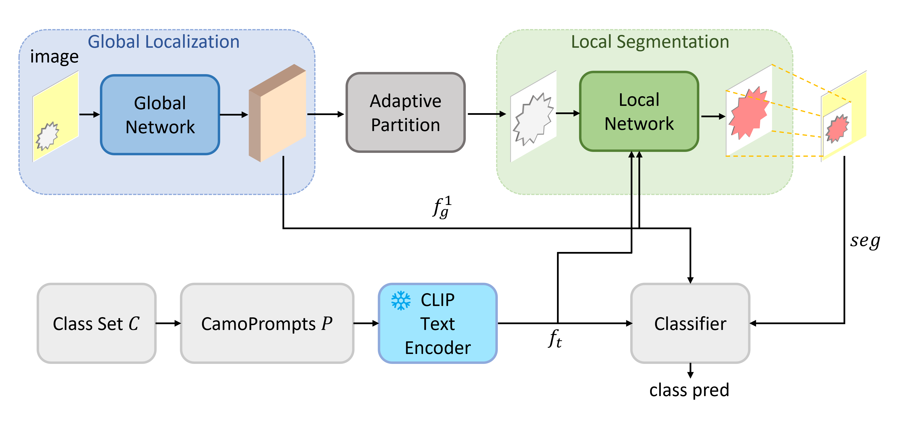

# GLARE: A Global-to-Local Framework with Adaptive Background Refinement for Open-Vocabulary Camouflaged Object Segmentation

<p align="center">
  
</p>

<p align="center">
  <em>Overview of the proposed GLARE framework.</em>
</p>

---

## Setup

### Dataset

1. Download the **OVCamo** dataset from the [official repository](https://github.com/lartpang/OVCamo).
2. Update the dataset path in `./env/splitted_ovcamo.yaml`.

### Environment

1. Install dependencies:

```bash
pip install -r requirements.txt
```

2. The required versions of `torch` and `torchvision` are listed in the comments of `requirements.txt`.

---

## Training

```bash
python ./main.py \
  --config ./configs/glare.py \
  --model-name GLARE
```

---

## Inference

```bash
python ./main.py \
  --config ./configs/glare.py \
  --model-name GLARE \
  --evaluate \
  --load-from <path_to_checkpoint>
```

---

## Pretrained Checkpoint

Download the released checkpoint using `gdown`:

```bash
pip install gdown
mkdir -p ckpt
gdown 124_QULmTNLudavpsiVCdqruKH5JOP_u3 -O ckpt/release-ckpt.pth
```

---

## Evaluate the Released Checkpoint

```bash
python ./main.py \
  --config ./configs/glare.py \
  --model-name GLARE \
  --evaluate \
  --load-from ./ckpt/release-ckpt.pth
```

